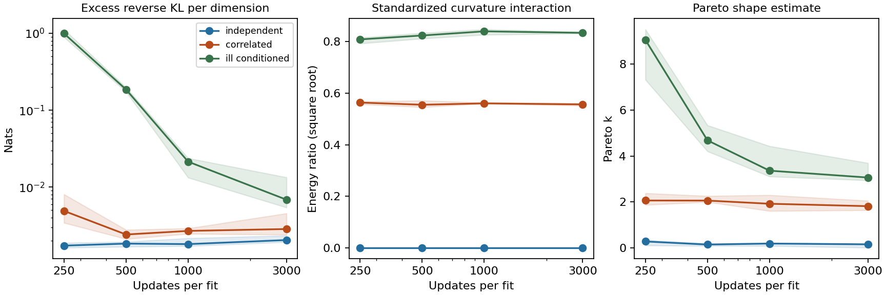

# Task 002 · What four metered MFVI fits can diagnose

**On these nine Gaussian instances, the profile exposed two simultaneous problems.** Additional training substantially reduced optimization error on the rotated targets. Even after the four endpoint distributions came close together, they assigned too little variance to important posterior directions. Curvature and importance weights exposed that discrepancy. A single fixed-step trajectory statistic could give a different impression from the fitted distributions or the independent gradient measurement.

## Design and target access

The main comparison used the nine Task 001 archived covariance matrices, dimensions 10, 50 and 100, four dispersed starts, and four fixed horizons. Starts and training draws were paired across horizons. Each endpoint received fresh independent evaluation draws for that horizon. The three controls were fixed in advance on the correlated 10-dimensional target. Each cell contains one target instance. Variation across the four fits measures optimizer and diagnostic randomness conditional on that instance.

Inference used only dimension, an opaque ID, zero/unit references, and metered primitives for an unnormalized log density. The Gaussian backend implements exact derivatives internally. The general autodiff adapter obtains the negative Hessian action by differentiating a gradient-vector contraction. Inference neither constructs a dense Hessian nor receives the Gaussian precision or normalizing constant. This is a tested interface between trusted components in the same process. Oracle calculations run after each profile and are written to a sibling evaluator file.

## Results at 3,000 updates

The gap is excess reverse KL over the best diagonal Gaussian, and the floor is irreducible reverse KL. Both are evaluator-only nats, as is forward KL. Interaction is the square root of estimated off-diagonal energy divided by total standardized curvature energy. Pair is the largest of the six symmetrized KL distances in joint nats. R̂ is the largest coordinatewise rank/folded split R̂. Other fit-dependent entries are medians of four. ESS is raw weight ESS from 1,024 iid proposal draws. Values below 10⁻¹² appear as zero here.

| Target | d | Gap | Floor | Forward KL | Pair | R̂ | Interaction | Pareto k | ESS |
|---|---:|---:|---:|---:|---:|---:|---:|---:|---:|
| Independent | 10 | 0.0265 | 0 | 0.0282 | 0.0707 | 1.02 | 0 | 0.250 | 963 |
| Independent | 50 | 0.104 | 0 | 0.106 | 0.242 | 1.03 | 0 | 0.181 | 820 |
| Independent | 100 | 0.205 | 0 | 0.204 | 0.484 | 1.03 | 0 | 0.153 | 673 |
| Correlated | 10 | 0.0444 | 2.20 | 9.63 | 0.0999 | 1.03 | 0.538 | 0.916 | 14.3 |
| Correlated | 50 | 0.150 | 11.1 | 52.6 | 0.281 | 1.04 | 0.555 | 1.35 | 2.50 |
| Correlated | 100 | 0.284 | 22.3 | 105 | 0.639 | 1.05 | 0.556 | 1.82 | 1.66 |
| Ill-conditioned | 10 | 0.0594 | 7.68 | 154 | 0.0943 | 2.12 | 0.832 | 1.02 | 12.4 |
| Ill-conditioned | 50 | 0.512 | 35.7 | 442 | 0.434 | 2.19 | 0.826 | 2.17 | 4.98 |
| Ill-conditioned | 100 | 0.685 | 72.3 | 852 | 0.687 | 2.51 | 0.834 | 3.06 | 1.64 |



Lines show four-fit medians at dimension 100. Shading covers the observed seed extrema. Horizons share training streams, and these ranges do not measure across-instance uncertainty.

**Optimization and endpoint agreement.** At dimension 100 on the ill-conditioned target, median gap fell from 99.6 to 18.6, 2.14 and 0.685 nats. The worst initial-horizon fit had a 112.6-nat gap. The largest distance between endpoint distributions fell from 1,028 to 0.687 nats. At 3,000 steps the four gaps still ranged from 0.542 to 1.338 nats. Maximum R̂ remained 2.51 and the median standardized mean drift was 0.151. The trajectory window includes earlier movement. A small endpoint distance describes only the final fits.

The independent d=100 target showed a different pattern. Maximum R̂ fell from 1.77 to 1.03 while median gap moved from 0.173 to 0.205 nats. Extending constant-rate Adam improved agreement of window statistics without a monotonic improvement in the final fit. Independent gradient RMS at 3,000 steps was 0.097, against a noise RMS of 0.078. Subtracting these norms would not yield an unbiased stationarity measurement.

**Curvature, coverage and uncertainty.** On correlated d=100, the final interaction estimates ranged from 0.551 to 0.562, raw ESS from 1.02 to 2.86, and forward KL from 105.1 to 107.2 nats. On rotated d=100, interaction ranged from 0.832 to 0.838, raw ESS from 1.05 to 2.21, and forward KL from 850 to 855 nats. The median worst-coordinate marginal variance ratio was 0.0313 on the latter target. A family close to its reverse-KL optimum can therefore carry very little importance mass in a sample of this size. Independent targets had numerically zero interaction. The largest curvature-variation ratio anywhere in the study was 1.55 × 10⁻¹⁶, consistent with a constant Gaussian Hessian.

The two-way bootstrap resamples the same directions across locations. At d=100 on the rotated target the median lower and upper bootstrap endpoints were 0.778 and 0.827, against a median point estimate of 0.834. The direction sample variance can decrease under resampling, and a percentile range can miss the original estimate. These intervals have no established coverage at J=8 and R=16. The corresponding Pareto shapes ranged from 2.94 to 3.69. Such extreme estimates identify a problematic empirical tail fit, with little basis for interpreting their numerical size precisely. Across main-study fits the importance reference was exceeded in 0/48 independent, 46/48 correlated and 48/48 rotated fits. The other two correlated fits illustrate why the reference cannot certify posterior accuracy. Seven of the 156 independent endpoint ELBO estimates differed from the exact unnormalized oracle ELBO by over two estimated standard errors. The absolute ELBO includes the target's unknown log normalizer.

## Controls and false reassurance

The table compares the same correlated d=10 target. Each profile contains all four starts. Gaps in parentheses span the four fits. Gradient is standardized RMS, reported as a four-fit median.

| Arm | Updates | Median gap (range), nats | Pair max | Max R̂ | Gradient RMS | Median ESS |
|---|---:|---:|---:|---:|---:|---:|
| Dispersed, lr 0.03 | 250 | 0.0288 (0.0182–0.0551) | 1.21 | 4.26 | 0.0956 | 25.8 |
| Short budget | 5 | 13.5 (8.29–22.4) | 17.1 | Insufficient samples | 2.40 | 7.04 |
| Dispersed, lr 0.6 | 250 | 0.341 (0.262–0.614) | 0.937 | 1.16 | 0.261 | 49.7 |
| Common start, lr 0.03 | 250 | 0.0361 (0.0217–0.0518) | 0.0654 | 1.20 | 0.118 | 27.6 |

The short-budget arm exhausted its training allocation at the next complete batch. It retained four endpoints and all reserved diagnostics. Pairwise disagreement and gradient magnitude exposed incomplete fitting. Its two-observation late window also illustrates how a small measured drift over a short interval can mislead.

The high-rate arm completed every update with finite parameters. Its median optimization gap was nearly twelve times the standard arm's, even as maximum R̂ fell and ESS rose. The intervention produced poorer fits without numerical divergence. The common start sharply reduced the maximum pair distance, although the median gap and dependence remained comparable. Agreement depends on initialization. Evidence for multiple basins remains inconclusive in all arms.

## Cost, implementation and verification

The restored environment passed the original four tests and the independent audit of all 45 Task 001 fits. The new regression suite covers primitive counts and independent instrumentation, threaded atomic rejection, failures without refunds, denied-update immutability, matched-noise gradient and clamp derivatives, post-update indexing, RNG separation, additive shifts, independent ELBO, R̂ reference and edge cases, pairwise KL, Gaussian and varying curvature, diagonal affine transformations, and PSIS fixtures. The R̂ and PSIS reference is ArviZ 0.21.0. A zero-budget test caught a missing zero in the aggregate ledger before the smoke run. All 16 tests then passed, followed by the smoke audit. The final suite also tests the general matrix-free autodiff adapter, bringing the total to 17. A post-run numerical fix handles exactly constant non-binary floating-point trajectories. Recomputing all archived R̂ components reproduced their stored values exactly. Metric-specific JSON views were materialized from the recorded estimates without target calls.

| Profile or collection | Allocated TEU | Used TEU |
|---|---:|---:|
| Smoke, four fits | 5,648 | 5,648 |
| One standard profile, T=250 / 500 / 1000 / 3000 | 135,680 / 263,680 / 519,680 / 1,543,680 | Same as allocation |
| Short control | 10,241 | 10,240 |
| High-rate and common-start controls, each | 135,680 | 135,680 |
| All 39 study profiles | 22,446,081 | 22,446,080 |
| Study and smoke combined | **22,451,729** | **22,451,728** |

The study charged 11,292,928 density evaluations, 11,133,184 gradients and 19,968 point-direction HVPs. The smoke added 2,928, 2,672 and 48, respectively. Every full diagnostic allocation cost 7,680 TEU per profile, 5.66% of the shortest standard budget and 0.50% of the longest. The four planned training denials were the only denied study calls. There were no failed primitive evaluations. All 152 full-horizon study fits completed, and all four short-control fits reached their permitted endpoint.

The sequential one-thread study took 34.75 seconds after imports, including 28.48 seconds inside the probe and 0.049 seconds of privileged evaluation. Serialization and orchestration account for the remainder. Process high-water memory reached 339 MiB. Smoke elapsed time after imports was 0.045 seconds. Timing is specific to the analytic NumPy Gaussian provider and this host. TEU counts exclude test fixtures, independent audits, bootstrap arithmetic and artifact I/O. A nonlinear autodiff backend can change the relative time per primitive substantially.

## Scope and next experiment

These data distinguish severe incomplete fitting from persistent mean-field error in controlled cases with an oracle. They do not calibrate a decision rule for unknown targets. An elevated gradient and strong dependence can occur together. All four runs can miss the same remote mode. Constant curvature across the sampled region carries little evidence about geometry elsewhere. The study used one fixed instance per target and dimension and cannot estimate sensitivity or specificity across instances. The archived rotation remains historically reproducible through its stored matrix. The sign-fixed normal-matrix QR generator is available for a separately charged future protocol.

A next study should hold out complete instances, vary eigenvector orientations at fixed spectra, and include matched local geometries with and without remote mass. This would test whether the same diagnostics predict a downstream change in coverage or decision loss. Any comparison of more starts, an optimizer change or a covariance extension needs a matched end-to-end budget and its own preregistered losses.

## Reproduce and inspect

The inference and experiment source revision was `0ff075f`. [Frozen design](PROTOCOL.md) · [Per-fit measurements and oracle errors](per_fit.csv) · [Study index](results/index.json) · [Smoke index](smoke/index.json). Each study directory contains a deployable profile and a separate privileged evaluator record. Profile trajectory chunks are content-addressed relative to the results root. Hashes cover the uncompressed NumPy format, including dtype and shape. Equal training prefixes can share storage while consuming their full inference budget.

From the repository root, use new output paths for reproduction. The audit reads the recorded data without spending inference budget.

```bash
source /workspace/.venvs/agentic-vi/bin/activate
export UV_CACHE_DIR=/workspace/.cache/agentic-vi/uv
uv pip install --python "$VIRTUAL_ENV/bin/python" -r research/task002/requirements.txt
export OPENBLAS_NUM_THREADS=1 OMP_NUM_THREADS=1 MKL_NUM_THREADS=1
export MPLCONFIGDIR=/tmp/agentic-vi-mpl XDG_CACHE_HOME=/tmp/agentic-vi-cache
python -m unittest discover -s tests -v
python research/task002/audit.py research/task002/smoke --smoke
python research/task002/audit.py research/task002/results
python research/task002/study.py /tmp/task002-new-smoke --smoke
python research/task002/audit.py /tmp/task002-new-smoke --smoke
python research/task002/study.py /tmp/task002-new-study
python research/task002/audit.py /tmp/task002-new-study
python research/task002/summarize.py /tmp/task002-new-study /tmp/task002-fits.csv --figure /tmp/task002-horizons.png
```
