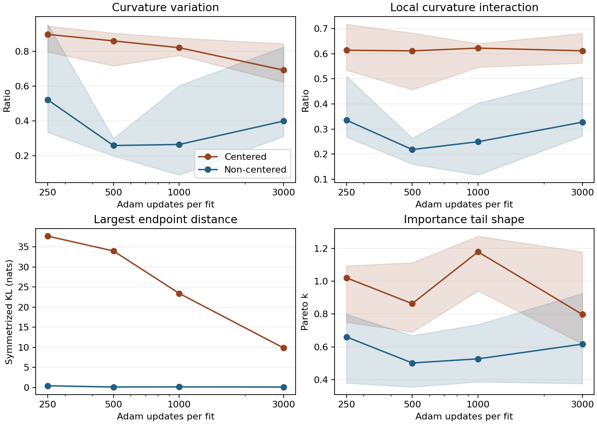
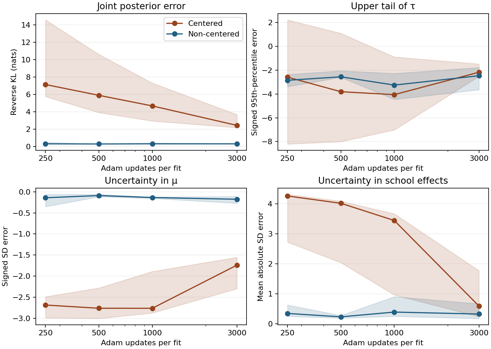

# Eight Schools: what VDP sees under a change of parameterization

**The non-centered fit had lower joint reverse KL in every paired run at every horizon.** The difference was visible by 250 updates. Centered fits kept improving through 3,000 updates, while the four non-centered fits had reached a similar neighborhood by 500. Non-centering also improved most school-level summaries. The advantage did not extend to every scale quantile, and neither fitted-distribution agreement nor a single importance-weight batch reliably ranked individual fits.

## Design and independent reference

The study used the Eight Schools observations and known sampling standard errors, with μ ~ N(0,25), τ ~ Half-Cauchy(5), θᵢ | μ,τ ~ N(μ,τ²) and yᵢ | θᵢ ~ N(θᵢ,σᵢ²). With η = log τ, both log joints include +η. The change θᵢ = μ + exp(η)zᵢ has Jacobian determinant exp(8η) at fixed μ,η. Its log cancels the eight centered normal scale terms. Density values at corresponding points agree after this adjustment.

Each representation used four dispersed diagonal Gaussian starts and the unchanged Task 002 probe. Equal seeds pair the numerical draws. Centered independent θ coordinates give independent scientific school effects within q. In the non-centered fit, even initially independent z coordinates yield scientific effects that share μ and τ. This changes the distribution of initial school effects, the geometry seen by Adam and the family attainable in scientific coordinates. The comparison measures their combined effect. [Frozen design](PROTOCOL.md)

**Reference calculation.** Conditional on τ=t and μ, the data are independent normals with variance σᵢ²+t². Define wᵢ=1/(σᵢ²+t²), V=(1/25+Σwᵢ)⁻¹ and m=VΣwᵢyᵢ. Then μ | t,y ~ N(m,V). After also integrating out μ, the data covariance is diag(σᵢ²+t²)+25·11ᵀ, with zero mean. Multiplying the resulting likelihood by the half-Cauchy prior leaves a scalar integral. We used 256-point Gauss–Legendre quadrature in the prior probability coordinate u=(2/π) arctan(t/5), where the prior is uniform.

With bᵢ=t²/(t²+σᵢ²), the conditional school mean after integrating μ is bᵢyᵢ+(1−bᵢ)m and the conditional variance is bᵢσᵢ²+(1−bᵢ)²V. Integrating conditional first and second moments gives marginal means and SDs. Averaging the conditional normal CDFs and inverting them gives marginal quantiles. The τ quantiles use its own integrated marginal CDF.

| Scientific coordinate | Mean | SD | 5th percentile | Median | 95th percentile |
|---|---:|---:|---:|---:|---:|
| μ | 4.397 | 3.318 | −1.083 | 4.415 | 9.817 |
| τ | 3.598 | 3.220 | 0.246 | 2.749 | 9.842 |
| θ₁ | 6.212 | 5.593 | −1.536 | 5.637 | 16.112 |
| θ₈ | 4.854 | 5.291 | −3.300 | 4.763 | 13.329 |

Log evidence was **−31.31134735229279**. An adaptive integral directly over t using the dense eight-dimensional marginal likelihood agreed within 4 × 10⁻¹⁵ log units. Refining the prior-scale quadrature from 128 to 256 nodes changed the 50 reported marginal statistics by at most 5.4 × 10⁻¹⁴. All ten marginals are recorded. [Reference values and accuracy checks](evaluation/reference.json)

The independent evaluator computes KL(q‖posterior) as log evidence minus E_q[log joint] minus Gaussian entropy. The Gaussian likelihood and conditional-prior expectations reduce to normal and lognormal moments. The log half-Cauchy factor requires a scalar Gaussian expectation. For non-centered q, θᵢ | η is normal with mean aμ+exp(η)aᵢ and variance vμ+exp(2η)vᵢ, where a,v are fitted coordinate means and variances. Integrating and inverting that CDF gives scientific school quantiles. This computation uses the fitted parameters only after inference. KL is invariant under the bijection when both densities are transformed together.

## What changed across budgets?

Fit-dependent columns are four-run medians. KL is in joint nats. Pair max is the largest of six symmetrized KL distances between fitted distributions within one profile. R̂ is the maximum rank/folded split statistic over the optimizer coordinates. Geometry and interaction are the existing standardized curvature variation and off-diagonal energy ratios. ESS uses 1,024 independent importance draws per endpoint.

| Form | Updates | KL (min–max) | Pair max | Max R̂ | Geometry | Interaction | Pareto k | Raw ESS |
|---|---:|---:|---:|---:|---:|---:|---:|---:|
| Centered | 250 | 7.141 (5.761–14.575) | 37.70 | 4.61 | 0.897 | 0.614 | 1.020 | 30.5 |
| Non-centered | 250 | 0.326 (0.302–0.501) | 0.416 | 3.40 | 0.521 | 0.336 | 0.661 | 399 |
| Centered | 500 | 5.900 (3.917–10.611) | 34.00 | 4.58 | 0.859 | 0.612 | 0.863 | 24.1 |
| Non-centered | 500 | 0.307 (0.306–0.312) | 0.109 | 2.38 | 0.257 | 0.219 | 0.502 | 429 |
| Centered | 1,000 | 4.681 (2.947–7.316) | 23.42 | 4.55 | 0.820 | 0.623 | 1.178 | 6.42 |
| Non-centered | 1,000 | 0.331 (0.298–0.408) | 0.135 | 1.38 | 0.263 | 0.250 | 0.527 | 219 |
| Centered | 3,000 | 2.447 (2.182–3.689) | 9.84 | 3.89 | 0.691 | 0.612 | 0.797 | 23.9 |
| Non-centered | 3,000 | 0.323 (0.309–0.327) | 0.100 | 1.07 | 0.398 | 0.328 | 0.616 | 354 |



Lines show medians. Shading spans the four observed fits. Pair max has one value per profile. Horizons have paired training histories. These envelopes reflect neither across-data-set variability nor confidence intervals.

**Early evidence and optimization.** At 250 updates the centered standardized gradient RMS was 1.16 against noise RMS 0.390. The non-centered values were 0.120 and 0.080. The sampled geometry, fitted-pair distances and weights already favored non-centering at that horizon, while the centered fit still had substantial room to improve. At 3,000 updates centered gradient RMS was 0.133 against noise 0.104, yet maximum pair distance remained 9.84 nats and median standardized mean drift was 0.365. An endpoint gradient close to its noise scale can coexist with substantial disagreement. There is no analytical family optimum here to separate the residual fitting gap from irreducible approximation error.

**Geometry.** In centered coordinates the school-effect curvature scales as exp(−2η), so draws at different τ encounter different stiffness. In non-centered coordinates the z prior has unit curvature, while the likelihood through μ+exp(η)z still contributes varying curvature. Both parameterizations showed variation well above the numerical zero observed for Gaussian targets in Task 002. The centered median was higher at all horizons. The statistic uses each final q's scale and sampled locations. For example, non-centered run 3 at 3,000 steps had geometry 0.825, overlapping centered runs (0.621–0.843), despite KL of 0.321. Its two-way bootstrap sensitivity range was 0.099–0.880. Eight locations and sixteen shared directions can describe local variation but cannot identify a funnel or reliably rank every fit. Negative directional curvatures occurred in some early centered fits. At the final horizon neither arm sampled a negative direction.

## Scientific accuracy and counterexamples



At 3,000 updates, median signed μ mean error was −2.407 centered and +0.090 non-centered. Median signed μ SD error was −1.740 and −0.177 respectively. For the eight schools, the mean absolute errors across schools were 2.368 versus 0.381 for means, 0.589 versus 0.322 for SDs, and 3.240 versus 1.082 for 95th percentiles (medians across fits). [All endpoint statistics and errors](evaluation/) · [Per-fit comparison](evaluation/per_fit.csv)

**Agreement and accuracy.** The closer non-centered endpoints tracked lower joint error in the between-arm comparison. Within that arm, max R̂ fell from 2.38 to 1.07 between 500 and 3,000 steps while median KL rose slightly from 0.307 to 0.323. Small between-fit distances also coexisted with missed scale uncertainty. The reference τ 95th percentile was 9.842. The final median fitted values were 7.667 centered and 7.373 non-centered. On this marginal, centered fits came closer despite their larger joint KL. At the lower tail the picture reversed: the centered median 5th percentile was 3.431, versus 0.698 non-centered and 0.246 in the reference. Even the better joint fit put too little mass near zero.

**Importance weights.** Median raw ESS favored non-centering at all horizons. The sample-size reference for Pareto k was exceeded in 15/16 centered and 6/16 non-centered fits. A single importance batch could reverse the ordering. At 3,000 steps, paired run 2 had k=0.619 and ESS=100 centered, versus k=0.926 and ESS=5.6 non-centered. Independent KL was 2.182 centered and 0.327 non-centered. A finite weight sample can miss an important region or contain one unusually influential draw. The data support a group-level association on this model, with substantial uncertainty about individual endpoints.

## Validation, cost and limits

All 21 tests passed before the study. The four new tests compare corresponding densities and normalized SciPy evaluations, check gradients and negative-Hessian actions against independent finite differences at three scales, check Gaussian conditionals using dense conditioning, verify integration by refinement, and check the fitted-distribution evaluator against a fixed scrambled Sobol integration fixture. The artifact audit verifies hashes, trajectory shapes and last states, importance-weight normalization, exact per-primitive charges and ledger reconciliation for every profile.

Each representation spent 135,680, 263,680, 519,680 and 1,543,680 target-evaluation-equivalent units. All 32 fits reached their planned horizons. Across eight profiles, 2,477,056 values + 2,444,288 gradients + 4,096 point-direction HVPs = **4,925,440 TEU**. Smoke spend was zero. There were zero denied or failed primitive calls. The inference driver took 19.81 s after imports, including 19.53 s inside VDP. Peak process RSS was 327 MiB. Audit, reference evaluation and figure generation took 6.58 s separately. These timings use one CPU thread and the existing PyTorch autodiff backend. [Raw profiles and ledgers](results/index.json) · [Audit totals](evaluation/audit.json)

Interpretation is conditional on one weakly informed hierarchy, these priors, these dispersed initializations, a diagonal family and a fixed Adam schedule. The experiment gives no estimate of how frequently the ranking holds across data sets or prior scales. It does not isolate a pure optimizer effect or establish optimality at 3,000 updates. Task 003 used the existing diagnostics, budget manager and optimizer without infrastructure changes.

## Reproduction

Use the Task 002 environment and run from the repository root. Source and frozen protocol were committed at `f8e3f40`. Use fresh output directories. To audit and regenerate the analysis without running inference, give the analysis command the archived `research/task003/results` directory as its first argument.

```bash
source /workspace/.venvs/agentic-vi/bin/activate
export OPENBLAS_NUM_THREADS=1 OMP_NUM_THREADS=1 MKL_NUM_THREADS=1
export MPLCONFIGDIR=/tmp/eight-schools-mpl XDG_CACHE_HOME=/tmp/eight-schools-cache
python -m unittest discover -s tests -v
python -m research.task003.study /tmp/eight-schools-new
python -m research.task003.analyze /tmp/eight-schools-new /tmp/eight-schools-analysis
```
